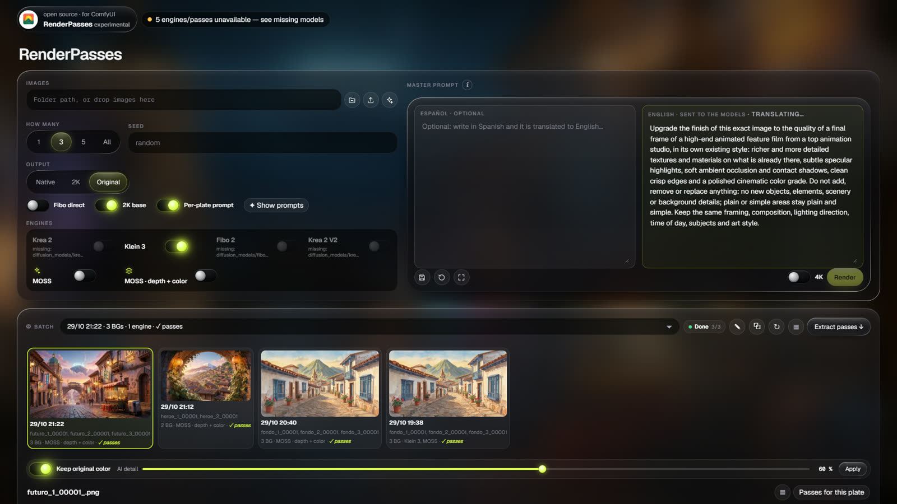
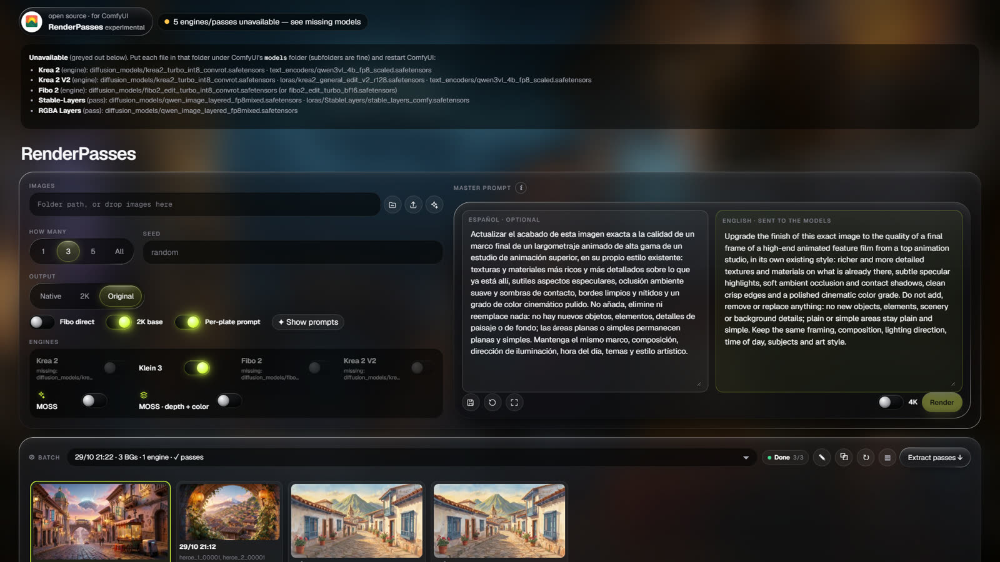
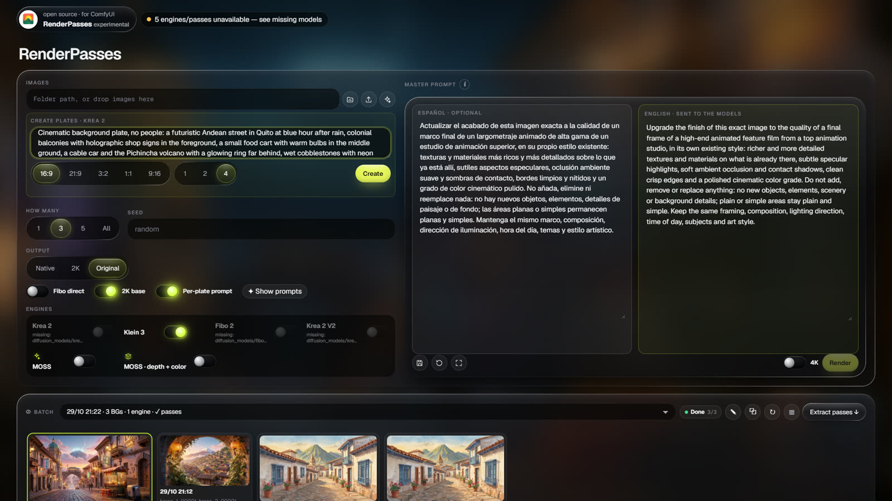
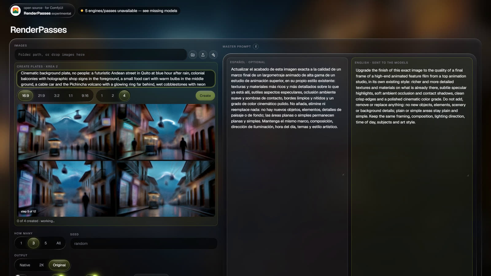
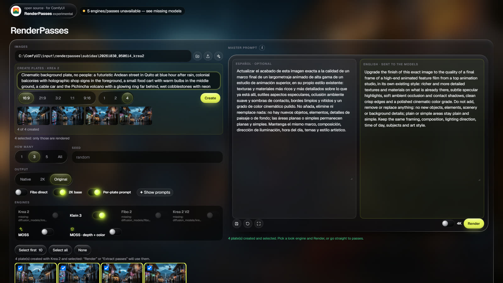
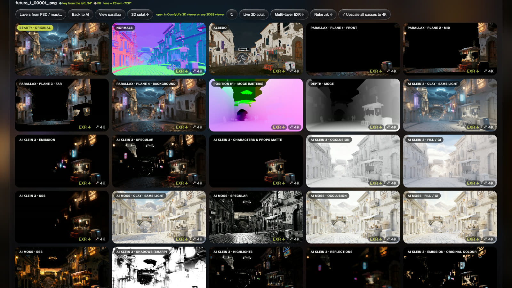
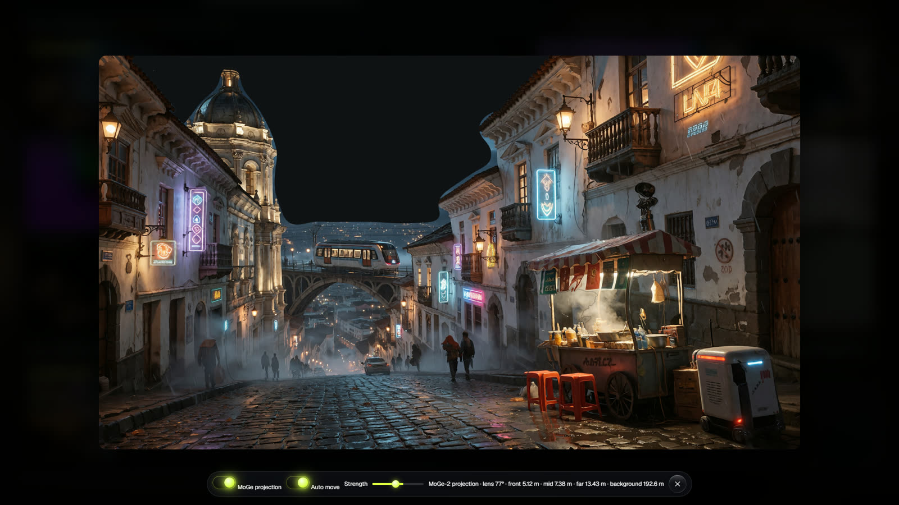
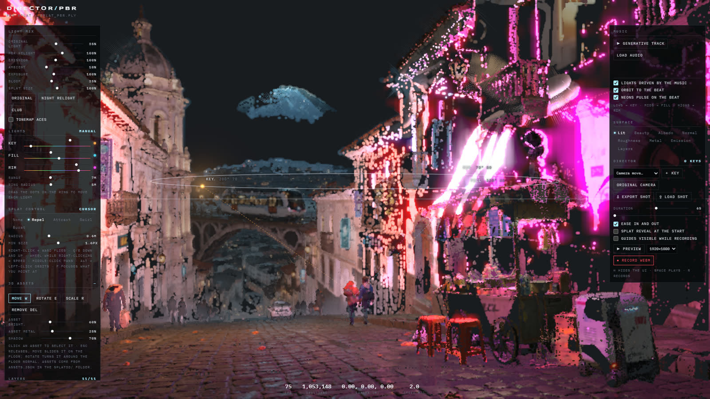

# RenderPasses · step-by-step guide

From an empty ComfyUI to a multilayer EXR in Nuke and a relightable 3D splat. Every picture below is a real screenshot of the app; the plates were made with the app itself (Krea 2).

**Contents**

1. [Install](#1-install)
2. [Open the app and check your install](#2-open-the-app-and-check-your-install)
3. [Bring plates, or create them with Krea 2](#3-bring-plates-or-create-them-with-krea-2)
4. [Look: finish every plate with one master prompt (optional)](#4-look-finish-every-plate-with-one-master-prompt-optional)
5. [Extract passes](#5-extract-passes)
6. [Parallax, 3D splat and the live relightable splat](#6-parallax-3d-splat-and-the-live-relightable-splat)
7. [Production mattes from the artist's PSD](#7-production-mattes-from-the-artists-psd)
8. [Take it to Nuke](#8-take-it-to-nuke)
9. [Use the nodes in your own graphs](#9-use-the-nodes-in-your-own-graphs)
10. [Troubleshooting](#10-troubleshooting)

---

## 1. Install

You need **ComfyUI 0.43 or newer**, on Windows, Linux or macOS.

```bash
cd ComfyUI/custom_nodes
git clone https://github.com/neuropixelplus/ComfyUI-RenderPasses
pip install -r ComfyUI-RenderPasses/requirements.txt
```

Restart ComfyUI. You don't need every model: install only the ones for the engines and passes you want. The **Models** table in the [README](../README.md#models) lists each file, the `models/` folder it goes in and its license. A good first set:

| To… | Get |
|---|---|
| Create plates | Krea 2 Turbo, its text encoder and VAE from [Comfy-Org/Krea-2](https://huggingface.co/Comfy-Org/Krea-2) |
| Depth, position, lens, parallax, splat | MoGe-3 (`geometry_estimation/moge_3_vitg_fp16.safetensors`) |
| Normals and albedo | Qwen-Image-Edit 2509 + the Marigold v2 LoRAs |
| AI light passes and the parallax fill | Klein 3 |

## 2. Open the app and check your install

A **RenderPasses** button appears in ComfyUI's top bar (also under *Extensions*). It opens the app in a new tab.



The pill at the top is the **install check**. It builds each engine's and each pass's graph and compares the models and nodes they use with what your ComfyUI has. Click it to see every missing file with the exact folder it goes in. Engines and passes that can't run are greyed out with the same note, so nothing fails halfway through a batch.



## 3. Bring plates, or create them with Krea 2

**Your own plates:** paste a folder path, drag images anywhere on the page, or use the upload icon. Pick the ones to work on.

**No plates yet?** Click the ✦ **Create** icon next to upload. Describe the plate (place, time of day, light, depth from foreground to far background), pick the aspect ratio and how many (1, 2 or 4), and press **Create**.



All plates are sampled as **one batch** with the *RenderPasses · KSampler (batch preview)* node, so you watch all of them form at once, live, step by step. ComfyUI's own preview only shows the first image of a batch.



When they finish they are loaded and selected exactly like uploaded images.



The recipe is ComfyUI's official Krea 2 Turbo template (8 steps, cfg 1). If the Turbo isn't installed, any Krea 2 fine-tune in `diffusion_models` is used, at 12 steps.

## 4. Look: finish every plate with one master prompt (optional)

Write a **master prompt** in English or Spanish (Spanish is translated locally). Tick one or more engines: Klein 3, Fibo 2, Krea 2, Krea 2 V2, MOSS or MOSS · depth + color. Choose the output size and press **Render**. Contact sheets compare the engines side by side.

- **MOSS · depth + color** keeps the exact framing: it is guided by the plate's own depth.
- **Keep original color** takes colour and light from the original and only the detail from the AI, so nothing drifts.
- **4K** upscales the result with SeedVR2 at the end.

You can skip this stage: passes can be extracted from the original plate itself (**Original (no engine)**).

## 5. Extract passes

In ③ **Extract passes**, pick the source (an engine's beauty, or the original), tick the passes and press **Extract passes**. Everything runs on ComfyUI's own queue; **Cancel** removes that batch's jobs and stops its background tasks.



| Group | Passes |
|---|---|
| Data | Depth, MoGe-3 position (P, metres) and lens, normals, albedo, raw lighting, fog, cavity, RGBA layers, parallax planes |
| AI light passes | clay (same light), fill / GI, occlusion, shadows, specular, emission, SSS, character and plant mattes, all aligned back to the plate |

Each tile downloads as a float **EXR** (colour passes in linear, data passes with their real values) and can be upscaled to **4K** one by one or all at once. Data passes are upscaled with clean resampling, so no texture is invented.

## 6. Parallax, 3D splat and the live relightable splat

**View parallax** opens the parallax planes stacked in 2.5D. The areas hidden behind each plane are already repainted, so the camera can move without holes. Move the mouse, or let it move on its own.



**3D splat** turns the parallax planes and MoGe's metric depth into a layered 3D Gaussian splat of the plate (`splat.ply`, about 2 M gaussians, about 10 s). It opens in ComfyUI's 3D viewer or any 3DGS viewer.

**Live 3D splat** builds a relightable splat scene from the passes (colour, albedo, normals, materials from the Cryptomatte layers, a floor measured with MoGe) and opens the **PBR Director** in a new tab. It runs live in the browser and has:

- key, fill and rim lights on a ring you drag;
- a mix between the original light and the relight;
- views per pass;
- a free camera with keys;
- WebM recording.



## 7. Production mattes from the artist's PSD

In production the background usually exists as a layered PSD, with each building, prop or plant on its own layer. Those layers *are* the object mattes.

1. On a plate in ③, click **Layers from PSD / mask…** and pick the PSD (`.psd` / `.psb`, up to 1.2 GB).
2. Instead of a PSD, you can pick a flat-colour ID mask (`.png`) **together with** its legend (`.json`), both at once. The legend is a list like `[{"name": "Church dome", "color": "#d94f2b", "group": "Buildings", "material": "stone"}]`.

RenderPasses then builds three things from those layers:

- the **Cryptomatte** (object, asset and material, named after the layers);
- the **Objects** (each layer cut out of the beauty);
- one matte per layer.

The parallax planes follow those elements.

- **Overscan is fine.** The plate is found inside a larger PSD canvas automatically, and the layers are cut to that frame.
- **Effects are set aside.** Fog, haze, VFX, cast shadows, layers with non-normal blend modes and layers under 30 % opacity get no ID and don't hide anything.
- **Back to AI** forgets the PSD and goes back to the automatic mattes.

## 8. Take it to Nuke

In the plate's header, **Multi-layer EXR ↓** downloads `pases_nuke.exr`, with every pass of the plate as named layers plus the Cryptomatte. **Nuke .nk ↓** downloads `pases.nk`, a script that reads that EXR and rebuilds the beauty (`albedo × raw lighting`), with the Cryptomatte and ZDefocus nodes already wired.

## 9. Use the nodes in your own graphs

| Node | What it does |
|---|---|
| **RenderPasses · KSampler (batch preview)** | ComfyUI's KSampler (same noise, same result), but its live preview shows every image of the batch in a grid |
| **RenderPasses · Layered Gaussian splat** | a plate's pass folder → ComfyUI's core `SPLAT` type and the plate's camera, for Render Splat, Transform Splat, Merge Splat and Save Splat |
| **RenderPasses · MoGe to EXR (P, depth, lens)** | MoGe's geometry → position (P) and depth EXRs plus the camera lens |

Every graph the app runs is saved to `user/default/workflows/RenderPasses/`, so you can open it in ComfyUI and change it. Two examples are in [`workflows/`](../workflows): `renderpasses_create_krea2.json` and `renderpasses_splat.json`.

## 10. Troubleshooting

- **An engine or pass is greyed out.** Click the install-check pill: it lists the missing file and its folder. Put the file there (subfolders are fine) and restart ComfyUI.
- **"It took too long".** The app waits while other jobs are ahead of yours in ComfyUI's queue. Only the time spent actually running counts.
- **Depth looks wrong on Windows with xformers.** Depth Anything can fail when xformers has no CUDA build. Without it, depth comes from MoGe automatically.
- **"psd-tools is not installed".** Run `pip install psd-tools` in ComfyUI's Python and restart ComfyUI.
- **Licenses.** RenderPasses is AGPL-3.0. Each model keeps its own license, and several are non-commercial, so check them before commercial work. The app shows each engine's license when you launch.
