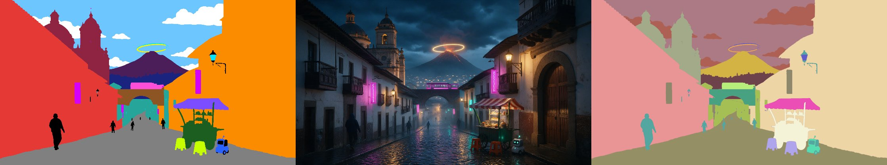

# Example: Cryptomatte from a colour mask + legend

A plate that was made **from** a flat-colour ID mask: every element of the scene has one exact colour, so the mask lines up with the plate pixel for pixel. Use it to try **Layers from PSD / mask…** without a PSD.

| File | What it is |
|---|---|
| `plate.jpg` | the plate (2048×1152) |
| `mask.png` | the ID mask: 19 exact colours |
| `legend.json` | one entry per colour: `name`, `color`, `group` (→ CryptoAsset), `material` (→ CryptoMaterial) |

**Try it**

1. Load `plate.jpg` in the app.
2. Run **Extract passes** with **Original (no engine)** as the source.
3. On the plate in ③, click **Layers from PSD / mask…** and select `mask.png` and `legend.json` together.

You get a Cryptomatte with 19 named IDs (Sky, Volcano, Train, Church, Food cart, Robot…), the Objects and one matte per layer.

This example is part of RenderPasses (AGPL-3.0); the image and the mask are © 2026 NeuroPixel+.
